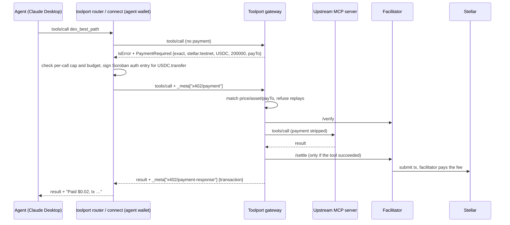

# Toolport

**Your agent pays per tool call, in USDC on Stellar, under a hard budget.** Toolport lets any AI agent (Claude Desktop, Cursor, your own) find paid MCP and HTTP tools, see the exact price before it buys, and pay for each call over [x402](https://github.com/coinbase/x402) with a Soroban auth entry. Every call is checked against a per-call cap and a persistent session budget before anything is signed. No API keys, no subscriptions, and the agent never needs XLM for fees.

- **Buy:** one discovery MCP (`toolport router`) searches the Toolport registry and curated JSON manifests of paid APIs and MCP tools, then quotes and pays under your caps.
- **Sell:** a server owner registers an MCP server with the Toolport gateway, sets a price per tool, and is paid in USDC for every successful call.

Toolport is the Stellar counterpart of [MCPay](https://github.com/microchipgnu/MCPay), built on the official x402 packages (`@x402/stellar`, `@x402/mcp`) and the [x402 MCP transport](https://github.com/coinbase/x402/blob/main/specs/transports-v2/mcp.md). Built for [Hack Meridian](https://www.hackmeridian.com/) 2026, Genesis path, Stellar Composed track.

> The project was renamed from StellarPay MCP. The workspace packages are still `@stellarpay/*`, the price meta key is still `stellarpay/price`, and the wallet lives in `~/.stellarpay/` (`STELLARPAY_WALLET`). The CLI installs as `toolport`, with `stellarpay` kept as an alias.

## Live deployment (Stellar testnet)

| | URL |
| --- | --- |
| Web app (landing, playground, catalog, seller dashboard) | `https://toolport.<domain>` |
| Gateway API | `https://api.toolport.<domain>/api/health` |
| Paid MCP endpoint (Stellar Oracle) | `https://api.toolport.<domain>/v1/mcp/<serverId>` |
| Upstream demo server | `https://oracle.toolport.<domain>` |

Placeholders: they get filled in after the Coolify deploy. The earlier Vercel deployment is listed under [Legacy: Vercel](#legacy-vercel).

## Quickstart: local development

Requires Node 22+.

```bash
npm ci
```

**1. Env files.** Each app reads its own env file. Copy the examples and fill them in. The real files are git-ignored, so keep secrets out of commits.

```bash
cp apps/gateway/.env.example apps/gateway/.env          # read by `npm run dev:gateway`
cp apps/demo-server/.env.example apps/demo-server/.env  # read by `npm run dev:demo`
cp apps/web/.env.example apps/web/.env.local            # read by Next.js
```

The gateway needs a facilitator, so pick one in `apps/gateway/.env`:
- OpenZeppelin: `FACILITATOR_URL=https://channels.openzeppelin.com/x402/testnet`, plus a `FACILITATOR_API_KEY` from <https://channels.openzeppelin.com/testnet/gen>.
- In-process: `FACILITATOR_SECRET_KEY=S...` set to any Friendbot-funded account.

Set `SESSION_SECRET` with `openssl rand -hex 32`. Without it, sessions reset whenever the gateway restarts.

**2. Wallets.** `wallet create` makes a keypair, funds it with Friendbot, adds the USDC trustline and, with `--usdc`, buys test USDC on the testnet DEX. Never commit wallet files.

```bash
STELLARPAY_WALLET=.wallets/provider.json npm run cli -- wallet create   # provider (seller) wallet
npm run cli -- wallet create --usdc 5                                   # agent wallet, saved to ~/.stellarpay/wallet.json
```

**3. Run the stack** in three terminals:

```bash
npm run dev:demo      # Stellar Oracle upstream on :4022
npm run dev:gateway   # gateway on :4021
npm run dev:web       # web app on :3000
```

**4. Seed the gateway.** The script signs in as the provider wallet (SEP-53, the same message Freighter signs), then registers and prices the demo server. You can run it more than once: an upstream that is already registered gets reused.

```bash
STELLARPAY_WALLET=.wallets/provider.json npx tsx scripts/seed-gateway.ts http://localhost:4021 http://localhost:4022/mcp
```

It prints the paid MCP URL. You can also register servers in the web app under **Sell** (`/dashboard`), signing in with Freighter.

**5. Pay for a call:**

```bash
npm run cli -- tools http://localhost:4021/v1/mcp/<serverId>
npm run cli -- call http://localhost:4021/v1/mcp/<serverId> dex_best_path '{"from":"XLM","to":"USDC","amount":"100"}' --max-per-call 0.05
```

Web routes: `/` landing, `/playground` (find a tool, price it, run it), `/catalog` (public registry), `/activity`, `/dashboard` (**Sell**: register and price servers), `/servers/[id]` (server detail).

## Quickstart: Docker Compose

The repo's `Dockerfile` has three targets (`web`, `gateway`, `demo`), and `docker-compose.yml` wires them together. To run them locally with published ports:

```bash
cp .env.example .env   # fill in SESSION_SECRET and the facilitator settings
docker compose -f docker-compose.yml -f docker-compose.local.yml up --build
```

That serves the web app on `http://localhost:3000`, the gateway on `http://localhost:4021` and the demo server on `http://localhost:4022`, all bound to 127.0.0.1. Inside the gateway container, `localhost` is the gateway itself, so seed the demo server by its service name:

```bash
STELLARPAY_WALLET=.wallets/provider.json npx tsx scripts/seed-gateway.ts http://localhost:4021 http://demo-server:4022/mcp
```

For this, `docker-compose.local.yml` turns on `ALLOW_PRIVATE_UPSTREAMS`. Only use that file on your own machine.

## The `toolport` command

During development, `npm run cli -- <command>` runs the CLI straight from the TypeScript source. To get the `toolport` command on your PATH from this checkout (after `npm ci`):

```bash
npm link -w packages/cli   # global symlink to the workspace; installs the `toolport` and `stellarpay` bins
toolport --help
```

Run it from the repo root. With `-w`, `npm link` links the named workspace rather than the root package. Use `npm unlink -g stellarpay` to remove it (`stellarpay` is the CLI package's name). The CLI hasn't been published to npm yet.

| Command | Purpose |
| --- | --- |
| `toolport wallet create [--usdc 5]` | New testnet wallet: keypair, Friendbot XLM, USDC trustline, optional test USDC |
| `toolport wallet show` | Address, XLM and USDC balances |
| `toolport wallet buy-usdc <amount>` | Buy USDC with XLM on the DEX (testnet helper) |
| `toolport tools <url>` | List the tools and prices of an MCP server |
| `toolport call <url> <tool> [json-args]` | Call one tool, paying if needed |
| `toolport router [--gateway <url>] [--manifest <path>]` | Discovery MCP with quotes, durable runs and budgets |
| `toolport connect --urls <a,b>` | Stdio MCP bridge to fixed paid servers |
| `toolport budget [--reconcile] [--release <id>]` | Session spend and held payments |

Common options: `--secret`, `--network stellar:testnet|stellar:pubnet`, `--rpc-url`, `--max-per-call <usd>`, `--budget <usd>`, `--session <name>`, `--state-db <path>`, `--allow-local`. Run `toolport --help` for the full list.

## Agent discovery router

One MCP searches tools across the Toolport registry and curated JSON manifests. The agent reads a schema and a quote, then buys a call under an explicit cap. HTTP and MCP tools go through the same USDC client and persistent wallet budget.

```bash
# On testnet, the default is the hosted registry (or TOOLPORT_GATEWAY_URL). Use an existing funded testnet wallet.
toolport router --max-per-call 0.05 --budget 1 --session hackmeridian
# Point it at your own gateway:
TOOLPORT_GATEWAY_URL=https://api.toolport.<domain> toolport router --max-per-call 0.05 --budget 1
# Local development:
toolport router --gateway http://localhost:4021 --allow-local
```

The router's registry default is `--gateway`, then `TOOLPORT_GATEWAY_URL`, then the hosted testnet registry built into the CLI. Today that built-in registry is the legacy Vercel gateway.

### Claude Desktop

Add the router to `claude_desktop_config.json`. If you ran `npm link -w packages/cli` and Claude Desktop can see your shell's PATH:

```json
{
  "mcpServers": {
    "toolport": {
      "command": "toolport",
      "args": ["router", "--max-per-call", "0.05", "--budget", "1", "--session", "hackmeridian"],
      "env": { "TOOLPORT_GATEWAY_URL": "https://api.toolport.<domain>" }
    }
  }
}
```

GUI apps often start without your shell PATH (for example under nvm). In that case, use node with the bin's absolute path:

```json
{
  "mcpServers": {
    "toolport": {
      "command": "node",
      "args": ["/absolute/path/to/repo/packages/cli/bin/stellarpay.js", "router",
               "--max-per-call", "0.05", "--budget", "1", "--session", "hackmeridian"],
      "env": { "TOOLPORT_GATEWAY_URL": "https://api.toolport.<domain>" }
    }
  }
}
```

Then ask: *"What's the best path to swap 100 XLM into USDC right now?"*

To expose fixed paid servers directly instead of the router, use `connect`: `"args": ["connect", "--urls", "https://api.toolport.<domain>/v1/mcp/<serverId>", "--max-per-call", "0.05", "--budget", "1"]`.

### Router tools

| Tool | Purpose |
| --- | --- |
| `search_tools` | Search the configured catalogs; shows sources that are unavailable or stale |
| `get_tool` | Read the full descriptor and exact input schema |
| `probe_tool` | Get an unpaid price challenge; no signature or purchase |
| `invoke_tool` | Execute using `id`, `args`, an explicit `maxAmount` and an `idempotencyKey` |
| `get_run` | Retrieve the stored result, payment receipt or error |
| `get_budget` | Read settled, pending and remaining USDC |

Example paid invocation:

```json
{
  "id": "registry:srv_02148cae805b:dex_best_path",
  "args": { "from": "XLM", "to": "USDC", "amount": "100" },
  "maxAmount": "0.05",
  "idempotencyKey": "my-swap-research-001"
}
```

Sending the same key again returns the original run. Reusing the key with different arguments or a different cap is a conflict. If a run crashes while `running`, it is kept and is not bought again automatically. `completed` means the transport returned a successful response, not that the answer is correct. Probes send unpaid requests, so only use them on providers you know are read-only: a provider that makes an operation free will execute that first request.

### Persistent budgets and receipts

CLI `call`, `connect` and `router` default to **0.05 USDC per call and 1 USDC per session**. State is stored next to the wallet in `agent.db` (override with `--state-db <path>`), scoped by wallet, network and `--session` name. A restart resumes the session's spend. Changing `--budget` or `--max-per-call` updates the limits but never resets spent or pending amounts, and there is no automatic daily reset. To give yourself a fresh budget on purpose, pick a new session name, but don't do that to get around unresolved payments.

The store reserves each call's price atomically before signing. A lost response or a missing or invalid receipt keeps the amount as a pending hold, including across restarts, and holds never expire on their own. Before recording a CLI payment as settled, the CLI checks the transaction over RPC: the USDC contract, payer, recipient and amount. If the provider reports a settlement that RPC can't confirm yet, the agent still gets the paid result, and the amount stays pending with its transaction hash.

```bash
toolport budget                     # spend, pending, remaining and each open hold
toolport budget --reconcile         # settle holds whose transaction now verifies on-chain
toolport budget --release <hold-id> # you checked the wallet: this one was never paid
```

SDK users can opt into `store` and `verifyReceipts: true`. Otherwise the SDK keeps an in-memory session and trusts the provider's receipt. These are client-side limits, not on-chain smart-account policies.

### MPP Router APIs (mainnet only)

[`catalog/mpprouter.mainnet.json`](catalog/mpprouter.mainnet.json) lists the 448 payable APIs from [MPP Router](https://apiserver.mpprouter.dev)'s catalog: search, LLMs, market data, maps, scraping and more. The web catalog shows the same list. Exa search and Firecrawl scrape have exact input schemas; the rest accept the router's generic `query`/`body` arguments, with each entry's `docs` link and `priceHint`. It is opt-in and filtered out on testnet:

```bash
# Explicit mainnet configuration; use a dedicated funded wallet and a mainnet RPC.
STELLAR_RPC_URL=https://YOUR_MAINNET_RPC toolport router \
  --network stellar:pubnet --manifest catalog/mpprouter.mainnet.json \
  --max-per-call 0.01 --budget 0.10 --session web-research
```

When you configure a desktop MCP client, pass an absolute manifest path. HTTP arguments go in `args.body`, `args.query` and `args.pathParams`. MCP arguments go directly to the tool. Prices come from fresh exact USDC x402 challenges, not from catalog strings. MPP sessions and channels are not implemented; these examples use Router's x402 interface. This project hasn't tested paid delivery on mainnet; MPP Router itself has verified 27 of these with real paid runs (marked in the web catalog).

Regenerate both lists from a newer catalog snapshot with `node scripts/import-mpprouter.mjs [snapshot.json]`.

Provider requests validate and pin DNS addresses, reject private networks and redirects, and use bounded responses and timeouts. `--allow-local` turns on loopback for development; it does not allow arbitrary private subnets.

## Environment variables

Each app's `.env.example` documents its own variables. The root [`.env.example`](.env.example) is for Docker Compose.

| Service | Variables |
| --- | --- |
| Gateway | `PORT`, `PUBLIC_URL`, `STELLAR_NETWORK`, `STELLAR_RPC_URL`, `DATABASE_URL`, `DATABASE_AUTH_TOKEN`, `FACILITATOR_URL`, `FACILITATOR_API_KEY`, `FACILITATOR_SECRET_KEY`, `SESSION_SECRET`, `WEB_ORIGIN`, `ALLOW_PRIVATE_UPSTREAMS`, `AUTH_DISABLED` (dev only) |
| Demo server | `PORT`, `STELLAR_NETWORK`, and optionally `PAY_TO` plus a facilitator |
| Web, build time | `NEXT_PUBLIC_GATEWAY_URL`, `NEXT_PUBLIC_STELLAR_NETWORK`, `NEXT_PUBLIC_STELLAR_RPC_URL`, `NEXT_PUBLIC_DOCS_URL`, `NEXT_PUBLIC_REPO_URL`, `NEXT_PUBLIC_CLI_PATH`, `NEXT_PUBLIC_CLI_NPM`, `NEXT_PUBLIC_E2E_SIGNER` (local e2e only, never in a deployment) |
| Web, runtime | `PORT`, `HOSTNAME` |
| CLI | `TOOLPORT_GATEWAY_URL` (router registry override), `STELLARPAY_WALLET` (wallet file, default `~/.stellarpay/wallet.json`), `STELLAR_RPC_URL` |

The `NEXT_PUBLIC_*` variables are inlined into the browser bundle when it is built, so rebuild after you change them.

## Deploying on Coolify

The main deploy target is a self-hosted [Coolify](https://coolify.io) instance using the Docker Compose build pack: base directory `/`, compose file `docker-compose.yml`, and one domain per service.

| Service | Domain (Coolify syntax) |
| --- | --- |
| `web` | `https://toolport.<domain>:3000` |
| `gateway` | `https://api.toolport.<domain>:4021` |
| `demo-server` | `https://oracle.toolport.<domain>:4022` |

The full steps are in **[docs/deploy/coolify.md](docs/deploy/coolify.md)**. They cover env values, web build variables, health checks, seeding with `scripts/seed-gateway.ts`, the hairpin-NAT fallback, and why `ALLOW_PRIVATE_UPSTREAMS` must stay `false` on a shared host.

## Proven on testnet

These are real calls made with this repo (agent wallet → provider wallet, fee paid by the facilitator account):

| Flow | Tool | Price | Transaction |
| --- | --- | --- | --- |
| Gateway (flow A) | `dex_best_path` | $0.02 | [d99bae1f…](https://stellar.expert/explorer/testnet/tx/d99bae1f7b6ce74f61b03984591717e913e2c02effe98079fbcb84413ba7d3c9) |
| SDK server (flow B) | `account_summary` | $0.01 | [d8cbed10…](https://stellar.expert/explorer/testnet/tx/d8cbed10adb68f2cd3a9c33182310f111865bb987cf1315ae924fabbc33d236e) |
| Claude-Desktop-style stdio bridge | `dex_best_path` | $0.02 | [dbee8459…](https://stellar.expert/explorer/testnet/tx/dbee845929b6b1cc86dd61dd3a475acd1d73cb21b39964e4ed3cd90fbe8b7e2e) |
| Gateway + hosted OpenZeppelin facilitator | `dex_best_path` | $0.02 | [7333ab0e…](https://stellar.expert/explorer/testnet/tx/7333ab0e1ca876ad98aa792c4746bd37d818d9f82c752efc373e6ad2506dfd87) |
| Deployed gateway on Vercel + OpenZeppelin | `dex_best_path` | $0.02 | [b3168b85…](https://stellar.expert/explorer/testnet/tx/b3168b851ff33fc7cd7f64d1ef336bafa2187c64c5747cf39bcb99bc5e6efb76) |
| Router → our registry, verified on-chain | `dex_best_path` | $0.02 | [c31160c7…](https://stellar.expert/explorer/testnet/tx/c31160c7cc5a9191eb63c984b9876c2f5d2e87f6bfe5fc8de0e30432cd364d77) |
| Router, same idempotency key again | (stored run returned) | – | no transaction: not paid twice |
| Router, price above the call's cap | `dex_best_path` with `maxAmount: 0.001` | – | no transaction: refused before signing |

The router rows come from [`scripts/smoke-router.ts`](scripts/smoke-router.ts) (`npm run smoke:router`), which writes [`docs/verification/router-testnet.json`](docs/verification/router-testnet.json) with the run ids, results and remaining budget.

End to end (sign → verify → run tool → settle) took 4.5–9 s. With the OpenZeppelin facilitator, OpenZeppelin's own accounts submitted the transaction and paid the fee through a fee bump (0.0011777 XLM). The agent wallet spent only USDC.

## How it works



- **Payment.** x402 v2, scheme `exact`, network `stellar:testnet` (or `stellar:pubnet`), and the asset is the USDC SEP-41 contract. The agent signs only the Soroban authorization entry for `transfer(agent, payTo, amount)`. The facilitator wraps it in a transaction that the facilitator sources and pays for.
- **Failed tools are free.** If the upstream returns `isError` or fails, the gateway never settles, and the signed auth entry simply expires (about 60 s).
- **Prices are visible up front.** `tools/list` responses carry the price in the description and in `_meta["stellarpay/price"]`.
- **Guardrails on the agent side.** The client refuses any call above `--max-per-call` or beyond `--budget`, and tells the model why.

## Packages and apps

| Path | What it is |
| --- | --- |
| [`packages/core`](packages/core) | Shared x402-on-Stellar code: USDC units (7 decimals), facilitator clients (hosted or in-process), resource server, Horizon account helpers |
| [`packages/mcp`](packages/mcp) | `createPaidMcpHandler` with `server.paidTool(...)` for providers; `StellarPayClient` with spend limits for agents |
| [`packages/router`](packages/router) | Catalog adapters (registry, manifests), search, schema validation, unpaid quotes, durable runs and the discovery MCP |
| [`packages/cli`](packages/cli) | `toolport` CLI (alias `stellarpay`): `router`, `connect`, `wallet create/show/buy-usdc`, `tools`, `call`, `budget` |
| [`apps/gateway`](apps/gateway) | Hono gateway: paid MCP proxy at `/v1/mcp/:serverId` plus a REST API (wallet sign-in, registration, pricing, call log, stats), SQLite/libsql via Drizzle |
| [`apps/web`](apps/web) | Next.js web app: landing, playground, catalog, activity, seller dashboard with Freighter sign-in, server pages with revenue and transaction links |
| [`apps/demo-server`](apps/demo-server) | "Stellar Oracle" MCP server: `ping` (free), `account_summary` ($0.01), `dex_best_path` ($0.02, Horizon path finding) |
| [`Dockerfile`](Dockerfile), [`docker-compose.yml`](docker-compose.yml) | Images for `web`, `gateway` and `demo`, and the Compose setup used by Coolify |

### Monetize your own server with the SDK (no gateway)

```ts
import { createPaidMcpHandler } from "@stellarpay/mcp/server";
import { z } from "zod";

export const handler = createPaidMcpHandler((server) => {
  server.tool("ping", "Health check", {}, async () => ({ content: [{ type: "text", text: "pong" }] }));
  server.paidTool("dex_best_path", "Best DEX path between two assets", "$0.02",
    { from: z.string(), to: z.string(), amount: z.string() },
    async (args) => ({ content: [{ type: "text", text: await bestPath(args) }] }));
}, {
  payTo: process.env.PAY_TO!,                       // G... with a USDC trustline
  facilitator: { kind: "http", url: "https://channels.openzeppelin.com/x402/testnet", apiKey: process.env.FACILITATOR_API_KEY },
});
// Hono: app.all("/mcp", (c) => handler(c.req.raw))
```

## Gateway API

| Method and path | Auth | Purpose |
| --- | --- | --- |
| `ALL /v1/mcp/:serverId` | x402 | Paid MCP proxy (Streamable HTTP, JSON or SSE upstreams) |
| `POST /api/auth/challenge`, `POST /api/auth/verify` | – | Sign in with a SEP-53 signed message (Freighter `signMessage`) |
| `GET /api/me` | session | The signed-in address |
| `GET /api/servers` | – | Public registry (`?mine=true` with auth: your servers) |
| `POST /api/servers` | owner | Register an upstream; reads its tools; optional `prices` |
| `GET/PATCH/DELETE /api/servers/:id` | owner for writes | Server detail, listing, payTo |
| `PATCH /api/servers/:id/tools/:name` | owner | `{ price: "$0.02", enabled: true }` |
| `POST /api/servers/:id/refresh` | owner | Re-sync tools from the upstream |
| `GET /api/servers/:id/calls`, `/stats` | owner | Call log with explorer links; revenue, paid calls, payers |
| `GET /api/accounts/:address` | – | Balances and USDC trustline check |
| `GET /api/health` | – | Facilitator and database reachability |

Upstream URLs are shown only to the owner, because anyone holding one could call the tools without paying.

Built-in hardening:
- **No SSRF.** A hosted gateway refuses upstreams that resolve to loopback, private, link-local or metadata addresses, both at registration and on every request. `ALLOW_PRIVATE_UPSTREAMS=true` opts out, and it is on by default when `PUBLIC_URL` is localhost.
- **New tools start closed.** If the upstream adds a tool after registration, the tool stays hidden and refused until the owner refreshes and prices it, so it is never served free by accident.
- **No batching around prices.** JSON-RPC batches that contain `tools/call` are refused.
- **Budgets hold under concurrency.** The agent reserves each call's price before signing, so parallel tool calls can't overshoot `--budget`.

## Tests

```bash
npm test             # unit and integration tests: units, paid SDK server, client limits, gateway end to end (mock facilitator), SSRF guard, wallet sign-in
npm run typecheck
# Spends up to 0.05 testnet USDC; writes a public proof, never a wallet secret:
STELLARPAY_WALLET=.wallets/provider.json npm run smoke:router
```

The gateway test runs a real upstream MCP server behind a real gateway. It covers quoting, paying, payment stripping, replay refusal, wrong-amount refusal, no charge on tool failure, free passthrough, batch refusal, late-added tools, stats and owner-only data. [`scripts/smoke-bridge.ts`](scripts/smoke-bridge.ts) drives the stdio bridge against live testnet the way Claude Desktop does.

## Stellar notes

- USDC on Stellar has **7 decimals**: $0.02 = `200000` base units.
- A `payTo` G-account needs a USDC trustline. The dashboard checks it.
- Testnet USDC: issuer `GBBD47IF6LWK7P7MDEVSCWR7DPUWV3NY3DTQEVFL4NAT4AQH3ZLLFLA5`, contract `CBIELTK6YBZJU5UP2WWQEUCYKLPU6AUNZ2BQ4WWFEIE3USCIHMXQDAMA`.
- Mainnet: set `STELLAR_NETWORK=stellar:pubnet`, `STELLAR_RPC_URL`, and the facilitator `https://channels.openzeppelin.com/x402`.

## Legacy: Vercel

Before the move to Coolify, Toolport (then StellarPay) ran as three Vercel projects. That deployment is still up, the CLI's router still uses its gateway as the default registry, and the Coolify guide uses its demo server as the hairpin-NAT fallback:

| | URL |
| --- | --- |
| Dashboard and registry | <https://stellarpay-web.vercel.app> |
| Gateway API | <https://stellarpay-gateway-ten.vercel.app/api/health> |
| Paid MCP endpoint (Stellar Oracle) | `https://stellarpay-gateway-ten.vercel.app/v1/mcp/srv_02148cae805b` |
| Upstream demo server | <https://stellarpay-demo.vercel.app> |

```bash
toolport call https://stellarpay-gateway-ten.vercel.app/v1/mcp/srv_02148cae805b \
  dex_best_path '{"from":"XLM","to":"USDC","amount":"100"}' --max-per-call 0.05
```

[`scripts/build-vercel.mjs`](scripts/build-vercel.mjs) bundles the gateway and demo server into single Node functions (Build Output API), which are deployed with `vercel deploy --prebuilt --prod` from each app directory. The gateway there uses [Turso](https://turso.tech) (hosted libSQL) through `DATABASE_URL` and `DATABASE_AUTH_TOKEN`, since functions have no disk.

## Research

[Research index](docs/research/README.md): Frames/MCPay mechanics, HackMeridian partners and materials, reusable components, MPP Router observations and source snapshots. Each report records its research date; this README describes the current implementation. Implementation and research were assisted by OpenAI Codex; external sources and dependencies are attributed in the reports and package manifests.

## Not done yet

- Publish the CLI and `@stellarpay/*` to npm. Until then, use `npm link -w packages/cli` or the local `node …/packages/cli/bin/stellarpay.js` path. The web app reads `NEXT_PUBLIC_CLI_PATH`, and `NEXT_PUBLIC_CLI_NPM=true` switches it to `npx`.
- Gateway payment claims are atomic in the shared database and bind real proofs to the payer authorization nonce. Sign-in challenges are stateless (HMAC), so they work across instances. There is no automated payment or run reconciliation worker yet.
- Freighter sign-in: the server side is verified with real SEP-53 signatures (`scripts/seed-gateway.ts`), but the browser extension flow hasn't been tested end to end yet.
- Stretch: sponsored reserves so agent wallets need 0 XLM, smart-account spending policies enforced on-chain, and automated reconciliation for unresolved payments.
