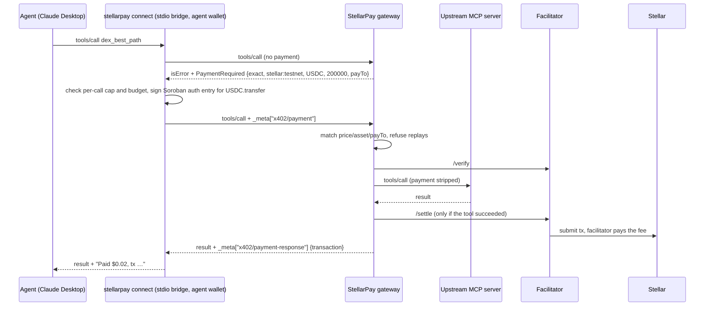

# StellarPay MCP

**Pay-per-call MCP tools, settled in USDC on Stellar.** An MCP server owner sets a price per tool; any AI agent (Claude Desktop, Cursor, your own) pays for each call with a Soroban auth entry and gets the result about 5 seconds later. No API keys, no subscriptions, and the agent never needs XLM for fees.

It is the Stellar counterpart of [MCPay](https://github.com/microchipgnu/MCPay), built on the official x402 packages (`@x402/stellar`, `@x402/mcp`) and the [x402 MCP transport](https://github.com/coinbase/x402/blob/main/specs/transports-v2/mcp.md). Built for [Hack Meridian](https://www.hackmeridian.com/) 2026, Genesis path, Stellar Composed track.

## Agent discovery router

One MCP can search tools across the StellarPay registry, [Rail402](https://rail402.dev)'s Bazaar of paid APIs and MCP tools, and a curated JSON manifest. The agent inspects a schema and quote, then buys a call under an explicit cap. HTTP and MCP tools use the same StellarPay USDC client and persistent wallet budget. For Bazaar listings, search uses Rail402's own ranking (BM25F + embeddings), so "what's the weather in Lisbon" finds a weather API that shares none of those words; it falls back to word matching if Rail402 is unreachable.

```bash
# Use an existing funded testnet wallet. On testnet the defaults are the deployed StellarPay
# registry and Rail402's free hosted Bazaar (https://testnet.rail402.dev).
npm run cli -- router --max-per-call 0.05 --budget 1 --session hackmeridian
# Local development / without Rail402:
npm run cli -- router --gateway http://localhost:4021 --allow-local --bazaar ""
```

Connect an MCP agent using the local CLI checkout:

```json
{
  "mcpServers": {
    "stellarpay": {
      "command": "node",
      "args": ["/absolute/path/to/stellarpay-mcp/packages/cli/bin/stellarpay.js", "router",
               "--max-per-call", "0.05", "--budget", "1", "--session", "hackmeridian"]
    }
  }
}
```

| Tool | Purpose |
| --- | --- |
| `search_tools` | Search configured catalogs; see unavailable/stale sources |
| `get_tool` | Read full descriptor and exact input schema |
| `probe_tool` | Get an unpaid price challenge; no signature or purchase |
| `invoke_tool` | Execute using `id`, `args`, explicit `maxAmount` and `idempotencyKey` |
| `get_run` | Retrieve the stored result, payment receipt or error |
| `get_budget` | Read settled, pending and remaining USDC |

Example paid invocation:

```json
{
  "id": "registry:srv_02148cae805b:dex_best_path",
  "args": { "from": "XLM", "to": "USDC", "amount": "100" },
  "maxAmount": "0.05",
  "idempotencyKey": "my-swap-research-001"
}
```

The same key retrieves the original run; changing its arguments/cap conflicts. A crashed `running` run is retained and is not automatically purchased again. `completed` means a successful transport response, not that an answer is correct. Probes send unpaid requests and should only be used for known read-only providers: a provider that makes an operation free can execute that initial request.

### Persistent budgets and receipts

CLI `call`, `connect` and `router` now default to **0.05 USDC/call and 1 USDC/session**. State is stored next to the wallet at `agent.db` (override with `--state-db <path>`), scoped by wallet, network and `--session` name. Restarting resumes its spend; changing `--budget` or `--max-per-call` updates the limits but never resets spent or pending amounts. There is no automatic daily reset. To intentionally allocate a new budget, choose a new session; do not use that to bypass unresolved payments.

The store reserves atomically before signing. Lost responses and missing/invalid receipts keep a pending hold, including across restarts. These holds never expire on their own. CLI payments verify the successful transaction over RPC, including USDC contract, payer, recipient and amount, before recording settlement. If the provider reports a settled payment that RPC can't confirm yet, the agent still gets the paid result, and the amount stays pending with its transaction hash.

```bash
npm run cli -- budget                     # spend, pending, remaining and each open hold
npm run cli -- budget --reconcile         # settle holds whose transaction now verifies on-chain
npm run cli -- budget --release <hold-id> # you checked the wallet: this one was never paid
``` SDK users can opt into `store` and `verifyReceipts: true`; otherwise the SDK retains an in-memory session and uses the provider receipt. These are client-side limits, not on-chain smart-account policies.

### External HTTP API examples (mainnet only)

[`catalog/mpprouter.mainnet.json`](catalog/mpprouter.mainnet.json) contains curated Exa search and Firecrawl scrape descriptors. It is opt-in and filtered out on testnet:

```bash
# Explicit mainnet configuration; use a dedicated funded wallet and a mainnet RPC.
STELLAR_RPC_URL=https://YOUR_MAINNET_RPC npm run cli -- router \
  --network stellar:pubnet --manifest catalog/mpprouter.mainnet.json \
  --max-per-call 0.01 --budget 0.10 --session web-research
```

Pass an absolute manifest path when configuring a desktop MCP client. HTTP arguments use `args.body`, `args.query` and `args.pathParams`; MCP arguments are passed directly to the tool. Prices come from fresh exact USDC x402 challenges, not catalog strings. MPP sessions/channels are not implemented; these examples use Router's x402 interface. Mainnet paid delivery has not been tested by this project. Do not import every catalog entry as a supported tool.

Provider requests validate and pin DNS addresses, reject private networks and redirects, and use bounded responses/timeouts. `--allow-local` enables loopback for development; it does not enable arbitrary private subnets.

## Research

[Research index](docs/research/README.md): Frames/MCPay mechanics, HackMeridian partners and materials, reusable components, MPP Router observations and source snapshots. Reports record their research date; this README describes the current implementation. Implementation and research were assisted by OpenAI Codex; external sources and dependencies are attributed in the reports and package manifests.

## Live demo (Stellar testnet)

| | URL |
| --- | --- |
| Dashboard and registry | <https://stellarpay-web.vercel.app> |
| Gateway API | <https://stellarpay-gateway-ten.vercel.app/api/health> |
| Paid MCP endpoint (Stellar Oracle) | `https://stellarpay-gateway-ten.vercel.app/v1/mcp/srv_02148cae805b` |
| Upstream demo server | <https://stellarpay-demo.vercel.app> |

Try it from a terminal with a funded testnet wallet (`npm run cli -- wallet create --usdc 5`):

```bash
npm run cli -- call https://stellarpay-gateway-ten.vercel.app/v1/mcp/srv_02148cae805b \
  dex_best_path '{"from":"XLM","to":"USDC","amount":"100"}' --max-per-call 0.05
```

## Proven on testnet

Real calls made with this repo (agent wallet → provider wallet, fee paid by the facilitator account):

| Flow | Tool | Price | Transaction |
| --- | --- | --- | --- |
| Gateway (flow A) | `dex_best_path` | $0.02 | [d99bae1f…](https://stellar.expert/explorer/testnet/tx/d99bae1f7b6ce74f61b03984591717e913e2c02effe98079fbcb84413ba7d3c9) |
| SDK server (flow B) | `account_summary` | $0.01 | [d8cbed10…](https://stellar.expert/explorer/testnet/tx/d8cbed10adb68f2cd3a9c33182310f111865bb987cf1315ae924fabbc33d236e) |
| Claude-Desktop-style stdio bridge | `dex_best_path` | $0.02 | [dbee8459…](https://stellar.expert/explorer/testnet/tx/dbee845929b6b1cc86dd61dd3a475acd1d73cb21b39964e4ed3cd90fbe8b7e2e) |
| Gateway + hosted OpenZeppelin facilitator | `dex_best_path` | $0.02 | [7333ab0e…](https://stellar.expert/explorer/testnet/tx/7333ab0e1ca876ad98aa792c4746bd37d818d9f82c752efc373e6ad2506dfd87) |
| Deployed gateway on Vercel + OpenZeppelin | `dex_best_path` | $0.02 | [b3168b85…](https://stellar.expert/explorer/testnet/tx/b3168b851ff33fc7cd7f64d1ef336bafa2187c64c5747cf39bcb99bc5e6efb76) |
| Gateway + Rail402 hosted facilitator (no API key) | `dex_best_path` | $0.02 | [5ae464f7…](https://stellar.expert/explorer/testnet/tx/5ae464f7f38f6023123a06f7f68dbaab0c1b1c996fd0c1eaccc852e0c47c6d86) |
| Router → our registry, verified on-chain | `dex_best_path` | $0.02 | [c31160c7…](https://stellar.expert/explorer/testnet/tx/c31160c7cc5a9191eb63c984b9876c2f5d2e87f6bfe5fc8de0e30432cd364d77) |
| Router → third-party seller found in Rail402 by "what's the weather in Lisbon" | `GET demo.rail402.dev/weather` | $0.001 | [9d1d9665…](https://stellar.expert/explorer/testnet/tx/9d1d9665682a7b7d2866ff77b6083b735df2cc473fc737dc61bfe389380886be) |
| Router, same idempotency key again | (stored run returned) | – | no transaction: not paid twice |
| Router, price above the call's cap | `dex_best_path` with `maxAmount: 0.001` | – | no transaction: refused before signing |

The router rows come from [`scripts/smoke-router.ts`](scripts/smoke-router.ts) (`npm run smoke:router`), which writes [`docs/verification/router-testnet.json`](docs/verification/router-testnet.json) with the run ids, results and remaining budget.

End to end (sign → verify → run tool → settle) took 4.5–9 s. With the OpenZeppelin facilitator, OpenZeppelin's own accounts submitted the transaction and paid the fee through a fee bump (0.0011777 XLM); the agent wallet spent only USDC.

## How it works



- **Payment.** x402 v2, scheme `exact`, network `stellar:testnet` (or `stellar:pubnet`), asset = the USDC SEP-41 contract. The agent signs only the Soroban authorization entry for `transfer(agent, payTo, amount)`; the facilitator wraps it in a transaction it sources and pays for.
- **Failed tools are free.** If the upstream returns `isError` or fails, the gateway never settles; the signed auth entry simply expires (~60 s).
- **Prices are visible up front.** `tools/list` responses carry the price in the description and in `_meta["stellarpay/price"]`.
- **Guardrails on the agent side.** The bridge refuses any call above `--max-per-call` or beyond `--budget`, and tells the model why.

## Components

| Path | What it is |
| --- | --- |
| [`packages/core`](packages/core) | Shared x402-on-Stellar code: USDC units (7 decimals), facilitator clients (hosted or in-process), resource server, Horizon account helpers |
| [`packages/mcp`](packages/mcp) | `createPaidMcpHandler` with `server.paidTool(...)` for providers; `StellarPayClient` with spend limits for agents |
| [`packages/router`](packages/router) | Catalog adapters, lexical search, schema validation, unpaid quotes, durable runs and discovery MCP |
| [`packages/cli`](packages/cli) | `stellarpay` CLI: `connect` (stdio bridge for Claude Desktop/Cursor), `wallet create/show/buy-usdc`, `tools`, `call` |
| [`apps/gateway`](apps/gateway) | Hono gateway: paid MCP proxy at `/v1/mcp/:serverId` + REST API (wallet sign-in, registration, pricing, call log, stats), SQLite/libsql via Drizzle |
| [`apps/web`](apps/web) | Next.js dashboard: public registry, Freighter sign-in, register and price tools, live revenue and transaction links |
| [`apps/demo-server`](apps/demo-server) | "Stellar Oracle" MCP server: `ping` (free), `account_summary` ($0.01), `dex_best_path` ($0.02, Horizon path finding) |

## Quickstart (testnet, about 5 minutes)

Requires Node 22+.

```bash
npm install
```

**1. Wallets.** `wallet create` makes a keypair, funds it with Friendbot, adds the USDC trustline and (with `--usdc`) buys test USDC on the testnet DEX.

```bash
STELLARPAY_WALLET=.wallets/provider.json npm run cli -- wallet create
npm run cli -- wallet create --usdc 5        # the agent wallet, saved to ~/.stellarpay/wallet.json
```

**2. A facilitator.** The quickest is Rail402's free hosted testnet facilitator, no key needed: `FACILITATOR_URL=https://testnet.rail402.dev`. Or get an OpenZeppelin key at <https://channels.openzeppelin.com/testnet/gen> and set `FACILITATOR_API_KEY`, or run the facilitator in-process with any Friendbot-funded account by setting `FACILITATOR_SECRET_KEY=S...`. See [`apps/gateway/.env.example`](apps/gateway/.env.example).

**3. Run everything** (three terminals):

```bash
npm run dev:demo                                                    # upstream on :4022
FACILITATOR_SECRET_KEY=S... AUTH_DISABLED=true npm run dev:gateway  # gateway on :4021
npm run dev:web                                                     # dashboard on :3000
```

**4. Register and price the demo server** in the dashboard (Connect Freighter, or "dev" + your provider address when `AUTH_DISABLED=true`), or with curl:

```bash
curl -X POST localhost:4021/api/servers -H "authorization: Bearer <provider G-address>" \
  -H 'content-type: application/json' \
  -d '{"upstreamUrl":"http://localhost:4022/mcp","prices":{"dex_best_path":"$0.02","account_summary":"$0.01"}}'
```

**5. Pay for a call:**

```bash
npm run cli -- tools http://localhost:4021/v1/mcp/<serverId>
npm run cli -- call http://localhost:4021/v1/mcp/<serverId> dex_best_path '{"from":"XLM","to":"USDC","amount":"100"}' --max-per-call 0.05
```

**6. Claude Desktop.** Add to `claude_desktop_config.json`:

```json
{
  "mcpServers": {
    "stellarpay": {
      "command": "node",
      "args": ["/absolute/path/to/stellarpay-mcp/packages/cli/bin/stellarpay.js", "connect",
               "--urls", "http://localhost:4021/v1/mcp/<serverId>", "--max-per-call", "0.05", "--budget", "1"]
    }
  }
}
```

Then ask: *"What's the best path to swap 100 XLM into USDC right now?"*

### Monetize your own server with the SDK (no gateway)

```ts
import { createPaidMcpHandler } from "@stellarpay/mcp/server";
import { z } from "zod";

export const handler = createPaidMcpHandler((server) => {
  server.tool("ping", "Health check", {}, async () => ({ content: [{ type: "text", text: "pong" }] }));
  server.paidTool("dex_best_path", "Best DEX path between two assets", "$0.02",
    { from: z.string(), to: z.string(), amount: z.string() },
    async (args) => ({ content: [{ type: "text", text: await bestPath(args) }] }));
}, {
  payTo: process.env.PAY_TO!,                       // G... with a USDC trustline
  facilitator: { kind: "http", url: "https://channels.openzeppelin.com/x402/testnet", apiKey: process.env.FACILITATOR_API_KEY },
});
// Hono: app.all("/mcp", (c) => handler(c.req.raw))
```

## Deploying to Vercel

Three Vercel projects. The gateway and demo server are bundled by [`scripts/build-vercel.mjs`](scripts/build-vercel.mjs) into single Node functions (Build Output API) and uploaded prebuilt; the dashboard is a normal Next.js deploy. The gateway's database is [Turso](https://turso.tech) (hosted libSQL), since functions have no disk.

```bash
# demo server (no secrets)
cd apps/demo-server && node ../../scripts/build-vercel.mjs . && vercel deploy --prebuilt --prod

# gateway: set DATABASE_URL, DATABASE_AUTH_TOKEN (turso db show --url / turso db tokens create),
# FACILITATOR_URL, FACILITATOR_API_KEY, SESSION_SECRET, PUBLIC_URL, WEB_ORIGIN with `vercel env add`
cd apps/gateway && node ../../scripts/build-vercel.mjs . && vercel deploy --prebuilt --prod

# register and price the demo server (signs in with the provider wallet, SEP-53)
npx tsx scripts/seed-gateway.ts https://<gateway> https://<demo>/mcp

# dashboard: set NEXT_PUBLIC_GATEWAY_URL
cd apps/web && vercel deploy --prod
```

## Gateway API

| Method and path | Auth | Purpose |
| --- | --- | --- |
| `ALL /v1/mcp/:serverId` | x402 | Paid MCP proxy (Streamable HTTP, JSON or SSE upstreams) |
| `POST /api/auth/challenge`, `POST /api/auth/verify` | – | Sign in with a SEP-53 signed message (Freighter `signMessage`) |
| `GET /api/servers` | – | Public registry (`?mine=true` with auth: your servers) |
| `POST /api/servers` | owner | Register an upstream; reads its tools; optional `prices` |
| `GET/PATCH/DELETE /api/servers/:id` | owner for writes | Server detail, listing, payTo |
| `PATCH /api/servers/:id/tools/:name` | owner | `{ price: "$0.02", enabled: true }` |
| `POST /api/servers/:id/refresh` | owner | Re-sync tools from the upstream |
| `GET /api/servers/:id/calls`, `/stats` | owner | Call log with explorer links; revenue, paid calls, payers |
| `GET /api/accounts/:address` | – | Balances and USDC trustline check |
| `GET /api/health` | – | Facilitator and database reachability |

Upstream URLs are only shown to the owner: anyone holding one could call the tools without paying.

Hardening built in:
- **No SSRF.** A hosted gateway refuses upstreams that resolve to loopback, private, link-local or metadata addresses, at registration and on every request (`ALLOW_PRIVATE_UPSTREAMS=true` to opt out; on by default when `PUBLIC_URL` is localhost).
- **New tools start closed.** A tool the upstream adds after registration is hidden and refused until the owner refreshes and prices it, so it is never served free by accident.
- **No batching around prices.** JSON-RPC batches that contain `tools/call` are refused.
- **Budgets hold under concurrency.** The agent reserves each call's price before signing, so parallel tool calls can't overshoot `--budget`.

## Tests

```bash
npm test             # unit and integration tests: units, paid SDK server, client limits, gateway end to end (mock facilitator), SSRF guard, wallet sign-in
npm run typecheck
# Spends up to 0.05 testnet USDC; writes a public proof, never a wallet secret:
STELLARPAY_WALLET=.wallets/provider.json npm run smoke:router
```

The gateway test runs a real upstream MCP server behind a real gateway and covers quoting, paying, payment stripping, replay refusal, wrong-amount refusal, no charge on tool failure, free passthrough, batch refusal, late-added tools, stats and owner-only data. [`scripts/smoke-bridge.ts`](scripts/smoke-bridge.ts) drives the stdio bridge against live testnet the way Claude Desktop does.

## Stellar notes

- USDC on Stellar has **7 decimals**: $0.02 = `200000` base units.
- A `payTo` G-account needs a USDC trustline; the dashboard checks it.
- Testnet USDC: issuer `GBBD47IF6LWK7P7MDEVSCWR7DPUWV3NY3DTQEVFL4NAT4AQH3ZLLFLA5`, contract `CBIELTK6YBZJU5UP2WWQEUCYKLPU6AUNZ2BQ4WWFEIE3USCIHMXQDAMA`.
- Mainnet: set `STELLAR_NETWORK=stellar:pubnet`, `STELLAR_RPC_URL`, and the facilitator `https://channels.openzeppelin.com/x402`.

## Not done yet

- Publish `stellarpay` and `@stellarpay/*` to npm (until then use the local `node …/stellarpay.js` path; the dashboard reads `NEXT_PUBLIC_CLI_PATH`, and `NEXT_PUBLIC_CLI_NPM=true` switches it to `npx`).
- Gateway payment claims are atomic in the shared database and bind real proofs to the payer authorization nonce. Sign-in challenges are stateless (HMAC), so they work across instances. There is no automated payment/run reconciliation worker yet.
- Freighter sign-in: the server side is verified with real SEP-53 signatures (`scripts/seed-gateway.ts`); the browser extension flow is not yet tested end to end.
- Stretch: sponsored reserves so agent wallets need 0 XLM; smart-account spending policies enforced on-chain; buyer dashboard and automated reconciliation for unresolved payments.
