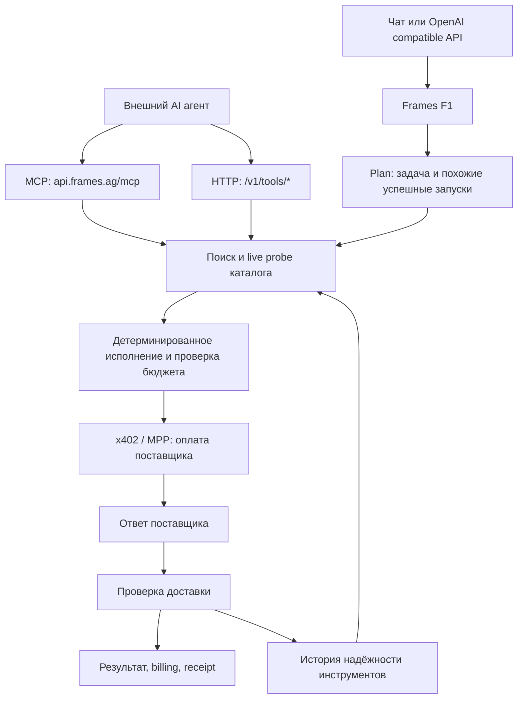

# Frames: публичная архитектура и механика

Дата проверки: 25 октября 2026. Исследование только официального сайта, документации, блога и связанной GitHub-организации. Ниже **заявленное поведение**, а не доказательство исполнения серверного кода. Никакие платные вызовы, аккаунты или авторизация в этом исследовании не использовались.

## Основной вывод

Frames продаёт единый доступ к сторонним платным данным и скрывает выбор поставщика, оплату и проверку доставки. Клиентский агент может самостоятельно искать и вызывать инструменты через MCP/HTTP; альтернативно управляемый Frames F1 выполняет исследование целиком. Это две разные ветки одного каталога и исполнения, с разной стоимостью. [Описание продукта](https://frames.ag/docs/introduction)

Схема синтезирована по источникам ниже. Названия внутренних сервисов и физическое разделение процессов из неё не следуют.

## F1 и маршрутизация

F1 описан как composite system специализированных моделей с детерминированным execution layer, а не собственная единая базовая модель. Три стадии: Plan выбирает инструменты и извлекает воспоминания похожих запусков; Execute проверяет доступность кандидатов и выполняет оплаченные вызовы; Verify проверяет ответы и покрытие задачи. Модель выбирает инструмент, execution layer разрешает платёж. При слабом покрытии заявлен один корректирующий проход. Блог заявляет порог уверенности >80% для списания, но методика вычисления confidence и калибровка не опубликованы. Успешные исполнения формируют memories, delivery/cost/latency влияют на выбор. [Техническое описание запуска F1](https://frames.ag/blog/introducing-frames-f1)

Та же публикация заявляет оплату через x402 и MPP, USDC и CASH, сети Solana (через pay.sh), Base и Tempo. Это описание интеграций, а не проверенные нами on-chain транзакции. Историческая база AgentWallet упоминается как источник обучающих данных; качество этой базы независимо не проверено. [Источник](https://frames.ag/blog/introducing-frames-f1)

## Каталог и прямое исполнение

HTTP инструменты позволяют вообще убрать F1 из цикла: решает внешний агент. Поиск `/v1/tools/search` принимает до четырёх формулировок; `/v1/tools/probe` проверяет до пяти инструментов; `/v1/tools/invoke` параллельно исполняет до десяти. Поиск может сразу вернуть `invoke_ready`, актуальную цену и `input_schema`. Оплата и delivery check остаются на Frames. Важная деталь: при ошибке поставщика **прямой invoke не подставляет другой инструмент автоматически**. Большие ответы выносятся в `/v1/runs/{id}/tool-results`. [HTTP контракт](https://frames.ag/docs/tool-endpoints)

MCP предоставляет ровно девять фасадных инструментов: `frames_search_tools`, `frames_get_tool`, `frames_probe_tools`, `frames_invoke_tools`, `frames_run_capability`, `frames_get_run`, `frames_get_receipt`, `frames_get_tool_results`, `frames_get_usage`. Платят только invoke и передача задачи F1. Долгий вызов возвращает `running` + `run_id`; дальше клиент опрашивает статус. `idempotency_key` защищает invoke от повторной оплаты. Передача `search_id` обратно при исполнении служит сигналом улучшения ранжирования. [MCP контракт](https://frames.ag/docs/mcp-tools)

Число инструментов не доказано: главная показывает 39 237 tools, 500+ merchants и 8 271 capabilities, а карточки тарифов пишут «+4000 endpoints». Это несовпадающие маркетинговые счётчики, не результат перечисления доступного каталога. [Главная](https://frames.ag/), [тарифы](https://frames.ag/pricing)

## API, состояние и авторизация

Официальный API: `https://api.frames.ag/v1`, Bearer API key, модель `frames-f1`. Есть OpenAI Chat Completions и Responses (`previous_response_id`), собственные `/v1/runs`, получение статуса, approve, cancel и tool-results. Документированы SSE, structured output и внешние function tools. Закрытие SSE не отменяет работу. Ответ расширяется `run_id`, `status`, `confidence`, `frames_usage`; полный run содержит result/usage/payments/tools_used. `frames.verification` принимает `none`, `basic`, `standard`, `strict`; внутренние различия уровней не раскрыты. [API](https://frames.ag/docs/api)

Для MCP используется remote Streamable HTTP endpoint `https://api.frames.ag/mcp`. Браузерные клиенты проходят вход и Approve через OAuth; headless клиенты могут отправлять Bearer API key. План и кредитный баланс относятся к аккаунту. [Подключение MCP](https://frames.ag/docs/mcp)

В модели API присутствует project: run доступен только своему проекту; policy может поставить run на паузу `requires_approval`, HTTP 402, без удержания кредитов. Типовые ошибки также включают `insufficient_credits`, `no_subscription`, `probe_rate_limited`, 401 и 429. Это документированный tenant/policy слой; его фактическая реализация и изоляция нами не тестировались. [Ошибки](https://frames.ag/docs/troubleshooting)

## Деньги и гарантия доставки

1 credit = $0.001. Прямой invoke тарифицируется как доставленные данные +15%; F1 — compute + доставленные данные +15% на оба компонента. До старта бюджет резервируется, после исполнения фактическая сумма списывается, остаток возвращается. Не оплачиваются проваленные run и вызовы без доставки; для F1 отдельно оговорён бесплатный исход без купленных данных и полезного ответа. Receipt содержит tool, amount/currency, network/tx_hash, delivered; billing — charged/budget/balance credits и percent remaining. [Правила биллинга](https://frames.ag/docs/pricing)

Планы: Free 3 000 credits/$0, Starter 10 000/$19, Pro 30 000/$49, Ultra 90 000/$129 в месяц. Лимит запроса: $1/$1/$3/$10 соответственно. Дополнительные кредиты покупаются через NEAR Intents с settlement в Solana USDC; зачисление после проверки settlement. Купленные кредиты бессрочны и расходуются после месячных. [Правила биллинга](https://frames.ag/docs/pricing)

## Инфраструктура и данные

Privacy Policy прямо называет Vercel для хостинга приложения, Neon для БД и Stripe для подписок/платежей. Хранятся email, runs, prompts и tool calls для исполнения, учёта, истории и агрегатных метрик надёжности. Для входа используется persistent first-party cookie. Поставщикам отправляются необходимые для запроса части prompt. Это первичный документ об обработчиках данных; ни Postgres-схема, ни auth-библиотека, ни deployment topology из него не известны. [Privacy Policy](https://frames.ag/privacy)

Официальный footer ведёт на GitHub-организацию `frames-engineering`. На доступной странице видны `skills`, `wordspace`, `ows` (fork), `prose` (fork), `lamble-ethglobal`; публичный backend F1 там не обнаружен. GitHub API в этой среде вернул 403, поэтому это не исчерпывающий аудит исходников. [Официальная организация](https://github.com/frames-engineering)

## Что ещё надо подтвердить наблюдением

### Дополнение: обнаруженные расхождения с живым публичным spec

Основной агент сохранил ответ `GET /v1/tools/spec` в `work/frames-tools-spec.json`; я прочитал этот файл. Это более близкий к исполнению контракт, но сами платные вызовы по нему не выполнялись. [Публичный spec](https://api.frames.ag/v1/tools/spec)

- В spec девять tools, но вместо документированного `frames_run_capability` есть `frames_cancel_run`. Следовательно, число совпадает, состав — нет.
- В invoke цена доставленного вызова описана точнее: `seller_price × 1.15 + $0.005`; фиксированная плата отсутствует в страницах docs. Pending/async ack и unverifiable charged call (`delivered:false, refundable:false`) оплачиваются `seller_price × 1.15`. Поэтому «данные не пришли — всегда бесплатно» нельзя использовать как проверенную универсальную гарантию.
- `completed` означает окончание исполнения, а успешность задачи находится в `outcome.answers_task`, `outcome.missing`, `outcome.unmet_constraints`.
- Cancel останавливает новые покупки на safe boundaries; уже начатые вызовы заканчиваются и выполненная работа списывается в пределах исходного лимита.
- Сохранённое тело ответа ограничено 1 000 000 символов; страницы чтения — до 60 000. `storage.truncated` означает, что хвост вообще не сохранён.

Эти детали относятся к содержимому возвращённого spec и ещё требуют проверки на реальном run. Они имеют приоритет над маркетинговым упрощением при проектировании клиента. [Источник](https://api.frames.ag/v1/tools/spec)

### Оставшиеся вопросы

- Какие модели/провайдеры реально реализуют planner, executor и verifier; что означает composite/fine-tuning.
- Из чего строится индекс, как обновляются схемы и цены, какой алгоритм ранжирования.
- Проверяет ли verifier соответствие намерению или только непустой transport response; как калиброван confidence.
- Как соотносятся данные каталога, live probe и readiness; чему равны реальные таймауты, лимиты и retry policy.
- Как устроены reserve/settle/refund и последствия отмены уже оплаченного вызова.
- Где живут API/worker процессы; какие queues, storage, auth provider и observability используются.
- Публичные read-only кандидаты для runtime проверки: `GET https://api.frames.ag/v1/models` и `GET https://api.frames.ag/v1/tools/spec` (документированы без ключа).

## Границы исследования

В Terms §4 явно есть запрет reverse engineering и создания напрямую конкурирующего routing product, а также обхода лимитов/доступа и неавторизованного probing уязвимостей. Здесь собраны и сопоставлены общедоступные материалы без входа, платных вызовов или обхода ограничений. [Terms](https://frames.ag/terms)
